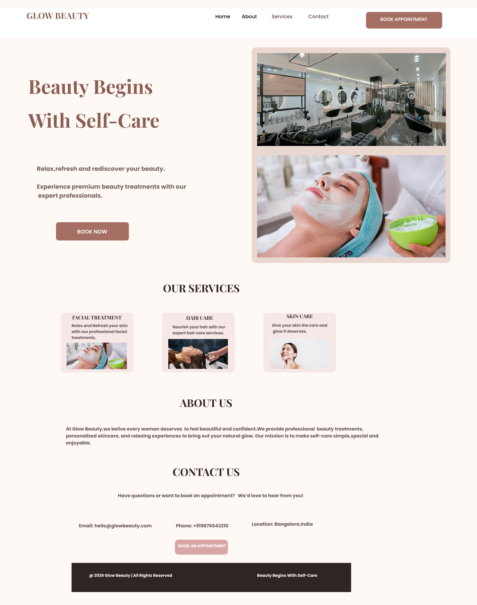

### Glow Beauty Studio – UI/UX Website Redesign

## Project Overview

Glow Beauty Studio is a beauty and skincare website redesign focused on creating a modern, attractive, and user-friendly experience.

## Project Type

UI/UX Design

## Project Goals

- Create an attractive homepage.
- Improve user navigation.
- Present beauty and skincare services.
- Provide a clean and responsive design.

## Internship

Future Interns – UI/UX Design Internship

## Tools Used

- Figma
- GitHub
- Unsplash

  ## Our Beauty Services

### Hair Care

### Skin Care

### Facial Spa

## Project Preview

## Project Status

Completed UI/UX Design Project.

## Figma Prototype

[View Glow Beauty Studio]
https://www.figma.com/design/Smx1yyN4vFjyKwpAcR1fmd/Future-Interns---Task-1---Glow-Beauty-Studio?node-id=0-1&t=X5EEl0IhSXg9F2tL-1

## Live Prototype

[View Glow Beauty Studio Prototype]
https://www.figma.com/proto/Smx1yyN4vFjyKwpAcR1fmd/Future-Interns---Task-1---Glow-Beauty-Studio?node-id=7-4&p=f&t=T1HTKgz0KWfsOKtZ-1&scaling=min-zoom&content-scaling=fixed&page-id=0%3A1&starting-point-node-id=7%3A4

## Copyright

© 2026 Glow Beauty Studio. All Rights Reserved.
